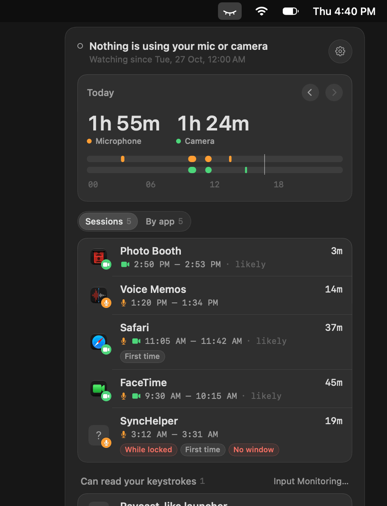
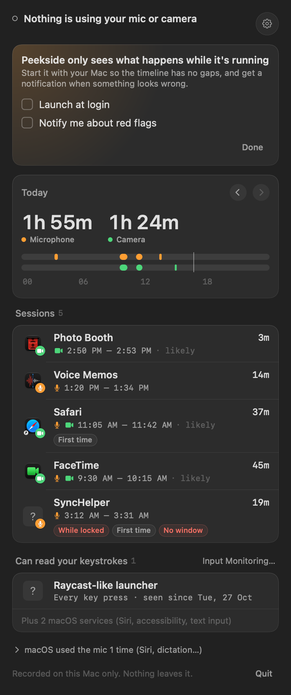
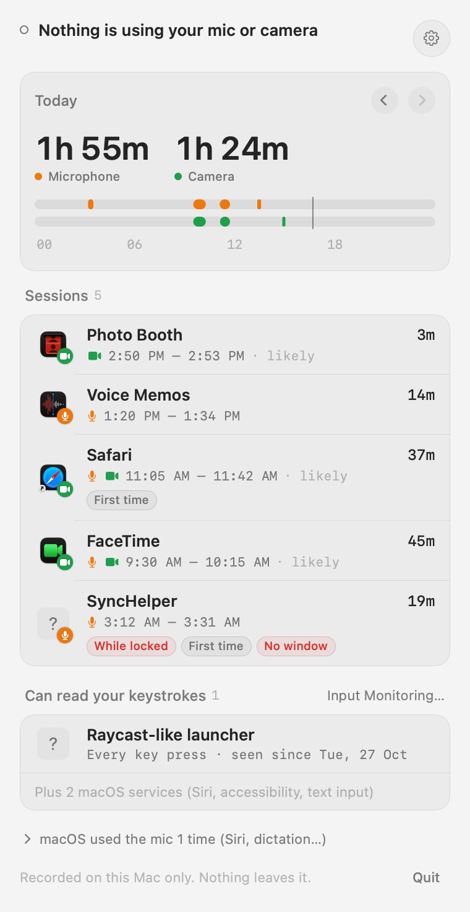
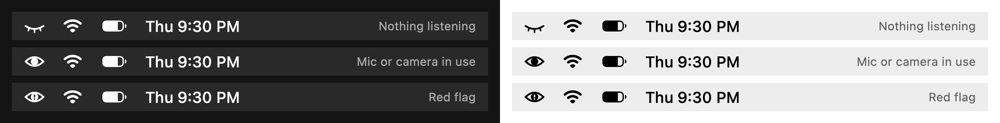

# Peekside

[](https://github.com/springmusk026/Peekside/actions/workflows/build.yml)
[](LICENSE)

**See which apps used your microphone and camera today, and which ones can read what you type.**

macOS shows an orange dot while an app uses your mic, but once the dot is gone, so is the record.
Peekside keeps it: a timeline of every app that used your microphone or camera, for how long, and a list of
every app that can read your keystrokes. Anything odd gets a red flag, like an app recording while your Mac
was locked.

<p align="center">
  
</p>

## Features

- **Who used the mic, by name**: per-app microphone use straight from macOS's audio system (CoreAudio process objects), including helpers like a browser tab's process, credited to their app.
- **Camera on and off**: exact times. macOS doesn't say which app turns the camera on, so Peekside names the likeliest one (the app that started the mic at the same moment, or the one you were using) and marks it as a guess.
- **Apps that can read your keystrokes**: every app receiving key presses through a keyboard event tap, which is how keyloggers work, with a link to remove access in Input Monitoring.
- **Red flags**: used while the screen was **locked**, an app using a sensor for the **first time**, or a process with **no window** at all. Optional notifications for each.
- **macOS kept separate**: Siri listening for "Hey Siri" keeps the microphone open without the orange dot. Peekside shows it, along with dictation and other system services, in its own section, so they don't drown out your apps.
- **A day at a glance**: total mic and camera time and a 24-hour timeline per day, 30 days back.
- **Private by design**: history stays in one JSON file on your Mac. No network, no account, no admin rights.
- **Command line**: `peekside`, `peekside now`, `peekside --days 7`, `peekside --json`.

<p align="center">
  
  
</p>

<p align="center">
  
</p>

## What it can't do

macOS has no public way to block the microphone or camera system-wide, or to see which app is
recording the screen, so Peekside doesn't claim to. It records only while it's running (turn on
**Launch at login** in Settings). The camera light on Macs is wired to the camera in hardware, so a
camera that's on always shows its light, with or without Peekside.

## Install

Requires macOS 14 Sonoma or later, on Apple silicon or Intel.

### Download

Get `Peekside.zip` from the [latest release](https://github.com/springmusk026/Peekside/releases/latest),
unzip it and move `Peekside.app` to Applications.

Peekside isn't notarized by Apple (it's a free side project), so macOS blocks the first launch. To allow it,
open **System Settings › Privacy & Security** and click **Open Anyway** next to the Peekside message, or run:

```sh
xattr -dr com.apple.quarantine /Applications/Peekside.app
```

### Build from source

With the Xcode command line tools (`xcode-select --install`):

```sh
git clone https://github.com/springmusk026/Peekside.git
cd Peekside
./build.sh        # builds, installs to ~/Applications and launches
```

### Command line

```sh
ln -sf /Applications/Peekside.app/Contents/MacOS/Peekside /opt/homebrew/bin/peekside
```

```console
$ peekside now
Microphone  FaceTime
Camera      on (macOS doesn't say which app)
Keystrokes  no apps can read them

$ peekside --days 7      # the last week of mic and camera sessions
$ peekside --json        # history as JSON
```

## Also from me

- [Portside](https://github.com/springmusk026/Portside): see every dev server running on your Mac, which project it belongs to, and stop it in one click.
- [Sweepside](https://github.com/springmusk026/Sweepside): find the gigabytes your old projects are sitting on and get them back in one click.

## License

[MIT](LICENSE)
